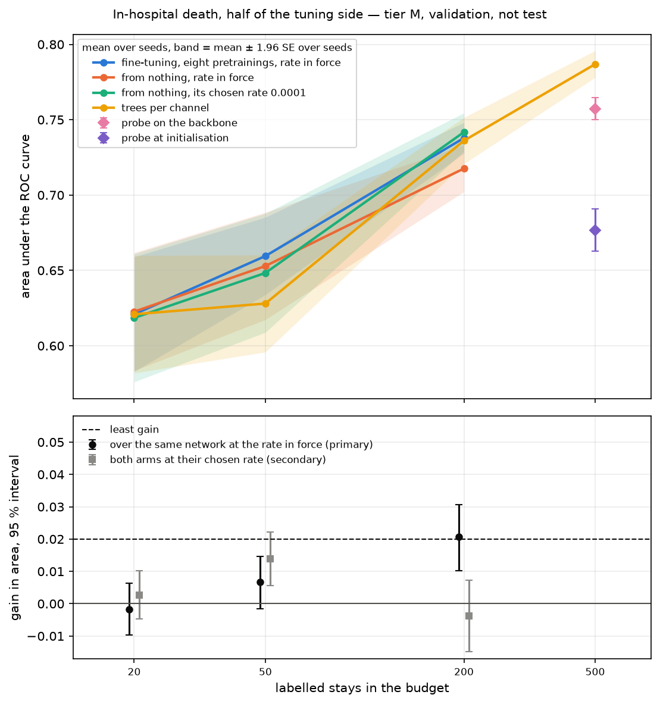

# Pretraining over cells

Whether the small encoder over cells of channel and time bin, pretrained without labels on
intensive-care stays, fine-tunes to a lower error at 20, 50 and 200 labelled stays than the same
shape trained from nothing; which of its recipes; and whether grids added to the stays help or
harm. The claim and its outcome levels are the register's, "Pretraining in the tasks' regime"
([preregistration](../preregistration.md)); the objective is
[ADR-0064](../adr/0064-a-pretext-over-cells-masked-before-the-layout.md).

## 2026-10-25 — declared before the run: ten pretrainings over cells read by fine-tuning at 20, 50 and 200 stays

**Questions.** (1) Does fine-tuning a backbone pretrained over cells on the 2012 and 2019 stays
gain over the small shape from nothing at 20, 50 and 200 stays of the half? (2) Do a forecast
tail, the count term or added grids move that gain? (3) Is the gain larger on the scored stays
the backbone read in pretraining? Beside them, descriptively: the probe at 500 stays, the pretext
on unread stays and the classical bar.

**Conditions.**

| | |
| --- | --- |
| Code | the commit that adds this section; pretrainings ordered from `841e30de` |
| Task | in-hospital death, `a6a9c653…`; half of the tuning side held out by seed 101 (1,997 stays learnt from, 2,000 scored); seeds 1 to 10; tier M; the validation side is not read |
| Pretrainings | the small shape (2 blocks × 64, 16 heads) over six-bin cells; half the 2012 stays of set A ranked by the run's seed, five passes an epoch, and every 2019 training stay; 19 epochs, read off a run at seed 0 by a rule written before it (`scripts/pretraining_budget_report.py`; `5655a49f`, read on no task) |
| Recipes | *base* `backbone-cells-clinical-m` (the pilot's masks, count weight 0.5); *tail* the same plus a forecast tail for half the windows; *no count* count weight 0; *tail, no count*; *grids* base plus C-MAPSS, SKAB and ESA-AD as sampled, the same exposure to the stays; each at seeds 1 and 2 (`-seed2`) |
| Platform | every pretraining on one Colab G4 (RTX PRO 6000) in six lanes under CUDA MPS, fp32; campaigns on the same card in lanes |
| Campaigns | `cell-pretraining-physionet2012` once per backbone (the small shape from nothing, fine-tuning at the rate in force and at 0.0001, 0.000333 and 0.003); `cell-pretraining-scratch-physionet2012` once (the network from nothing at the four rates); `cell-pretraining-probes-physionet2012` once per backbone (the closed-form probe over the blocks side by side, under the backbone and at its initialisation, at 500) |
| Worker | `data/report/t42c/worker-env.sh` (the rate in force 0.001), the backbone's weights per campaign |
| Classical bar | cells already read on the same half and seeds (`gap-to-the-trees.md`, 2026-10-23): trees per channel 0.621 / 0.628 / 0.736 at 20 / 50 / 200; the logistic head over the summaries 0.730 at 200; at 20 and 50, where that head was not read, the network over the same summaries, 0.644 / 0.674, a diagnostic and not a candidate |

The backbones and their weights:

| Recipe | Seed 1 | Seed 2 |
| --- | --- | --- |
| base | `ef2674dd` (`e9bf831a…`) | `e02dce87` (`b23be234…`) |
| tail | `8e9e5340` (`0b2a37e7…`) | `f7576057` (`4751c1aa…`) |
| no count | `eb1996e0` (`2f9f3fa8…`) | `8bb1dfbc` (`ac42481b…`) |
| tail, no count | `e60bdcf8` (`616d121e…`) | `f94c8154` (`f0ed74aa…`) |
| grids | `8b592bcc` (`8b079edd…`) | `34bc095b` (`f9f4851a…`) |

**What was seen before this section.** The ten pretrainings were run and accepted before it was
written, and none was read on a task. Their logs were read: every term of the pretext reached a
plateau except the count in one grids run, and the two seeds of a recipe agree within 0.011 in
every term on the stays. The trial ran every campaign at seed 1 under the budget run's backbone
and printed only the cells accepted (2; 5 and 4 a budget; 2,000 answers a side); the rate choice
and the transduction ran on them to files left unopened. The screen's rule, run on campaigns already read, repeats
+0.032 and +0.033 at 200 stays and T₁ of 0.037 and 0.030 (`few-label-fine-tuning.md`, 2026-10-22).

**Reading.** Pairs by `scripts/campaign_pairs_report.py` (10,000 resamples); a side of several
pretrainings is their mean, joined by `+`. The rule is `scripts/pretraining_screen_report.py`.

- *Spread.* s is the larger of 0.014 and fine-tuning's spread between pretrainings, by the
  registered formula over the five pairs that differ by seed alone, averaged over pairs and the
  three budgets.
- *Gains, screened.* Fine-tuning less the network from nothing, per recipe (n = 2) and over the
  eight clinical pretrainings (n = 8), against T = 2·√(SE² + (s²/2)/n), each given its level.
  Read descriptively: a screen confirms nothing.
- *Contrasts.* The tail (tail and tail-no-count against base and no-count, 4 against 4), the
  count (base and tail against no-count and tail-no-count) and the grids (grids against base,
  2 against 2), each against T = 2·√(SE² + (s²/2)·(1/n_a + 1/n_b)). The interaction is read
  descriptively.
- *Null pairs.* The network from nothing under the first campaign against each of the other
  nine at every budget, within ±0.02, or the reading stops.
- *Rates.* One rate per arm by the registered rule (`scripts/rate_choice_report.py`, 2,000
  resamples, seed 1): the network from nothing over its campaign; fine-tuning over all ten
  backbones together, since a rate chosen recipe by recipe would add the choice to its reading.
  Where several rates clear the bar, the largest gain is chosen.
- *Transduction.* `scripts/transduction_report.py` over the ten backbones: each one's gain on the
  scored stays it read and on those it never read (about 1,000 each), the mean gap per budget
  and its interval from one draw of stays shared by every backbone (2,000 resamples, seed 1).
  Descriptive; the interval holds the seeds as they ran.
- *Probe at 500.* The probe under the backbone less at its initialisation, per recipe, against
  the stage reader's threshold (s = 0.0057).
- *Pretext on unread stays.* `scripts/cell_pretext_audit.py --model trained --unread-units` and
  `--model initialisation` per backbone, the model beside `stacked`; 2019 on its validation side
  and the grids zero-shot for the clinical recipes (`--unset-rows mean`), descriptively.
- *Power for the confirmation.* `scripts/comparison_power_report.py` on these cells, at a gain of
  0.02 with this s, gives the pretrainings and seeds the confirming run needs.

**Predictions** (from earlier intervals, the lower edge where a gain is claimed).

| Reading | Prediction | Source |
| --- | --- | --- |
| Gain over eight, 20 and 50 | noise, inside [−0.029, +0.009] | fine-tuning under four pretrainings over raw tokens: −0.017 [−0.029; −0.004] at 20, −0.003 [−0.015; +0.009] at 50 (`few-label-fine-tuning.md`, 2026-10-22) |
| Gain over eight, 200 | inside [0.000, +0.033]: noise or real and small | +0.024 [+0.014; +0.033] there, against a network from nothing that read 0.666 on this half where the small shape reads 0.733 (`encoder-candidates.md`, 2026-10-23), so less is left to gain |
| Spread s | own spread at or below 0.025, so s in [0.014, 0.025] | fine-tuning's own spread between pretrainings 0.010 at 20 and 0.025 at 50 (`few-label-fine-tuning.md`) |
| Tail, count | within ±T at every budget | neither pretext variant replaced the mixture's masks by the probe at 50 (`pretext-variants.md`) |
| Grids | at or below zero, harm possible | the stays-alone backbone's probe gained up to 0.055 where the mixture's did not (`intensive-care-curve.md`) |
| Transduction | gap inside [−0.02, +0.02] at every budget | the pretext sees no label; continuing a backbone over both clinical corpora moved the probe at 500 by −0.000 [−0.007; +0.007] (`domain-continuation.md`) |
| Rates | none declared | no rate of either arm was read at 200 stays or below |
| Probe at 500 | within ±0.02 of the probe at initialisation | the probe gained nothing over an untrained encoder at 500 (`head-and-representation.md`) |
| Pretext, unread stays | the model above `stacked` on the presence (0.44) and on the mean (0.12); at initialisation below both | the audit of 2026-10-24 (`cell-pretext.md`) and the runs' validation, presence at 0.24 of the trivial cost (seen) |
| Classical bar | fine-tuning above the trees but below the network over the summaries at 50; within ±0.02 of the trees at 200 | the small shape from nothing 0.656 / 0.733 against the trees' 0.628 / 0.736 and the summaries' 0.674 at 50 on this half (`encoder-candidates.md`) |

**What follows.** The register's levels decide each gain. A factor moves off the base recipe for
the confirming run where its contrast exceeds T at 50 or 200 stays and lies below −T at none;
otherwise the base level stays. Grids join the confirming corpora by the same rule; otherwise the
stays alone. The 4.8M shape over cells is pretrained for the confirmation only if the gain over
eight is real and small or better at 50 or 200 stays. Fine-tuning's chosen rate is the one
confirmed. The gain on the unread stays is reported beside every gain; the confirming run reads
the 2019 stays in part as well, whatever the gap.

**Limitations.** The budget is a bound from above: the run that set it decayed its rate over 24
epochs, the recipes over 19. Under grids the kept epoch follows the mean validation over five
corpora, so it answers the grids in part. Two pretrainings a recipe give a coarse spread, bounded
below by the floor. The logistic head over the summaries was read at 200 and 500 stays only; at 20
and 50 the network over the same summaries stands in for it. The pretraining read about half the
scored stays.

## 2026-10-25 — Colab G4, fp32: at the rate in force fine-tuning gains 0.021 at 200 stays, and at the rate each arm keeps no gain remains there

**Question.** The three declared above, and beside them the rates, the probe at 500, the pretext
on unread stays and the classical bar.

**Conditions.** Twenty-one campaigns defined and ordered at `0b564de4` (ids in
`data/report/l32b3b/campaigns.txt`), run on one Colab G4 (RTX PRO 6000) under CUDA MPS, six
lanes an order, 126 lanes, the longest 301 s; every lane accepted (`accept-campaigns.sh`). The
reading is `read.sh` (export, pairs at 10,000 resamples, screen, rates, transduction) and
`read-chosen.sh` (the pairs at the chosen rates, secondary); the audit `audit.sh` on the M1 Pro
(MPS, fp32); power `power.sh`; the figure `curve.sh` (`scripts/label_curve_figures.py`).
CSV under `data/report/l32b3b/read/`.

**Checks before reading.** All held: every cell is in the grid; the network from nothing agrees
across the ten campaigns within ±0.0015 (bound ±0.02); s is 0.014, fine-tuning's own spread
between pretrainings, 0.013, lying under the floor.

**Area under the ROC curve**, mean over seeds 1 to 10 (fine-tuning and the probe: the mean over
the eight clinical pretrainings within a seed; fine-tuning's rate was chosen over all ten). In the
figure the upper bands overlap because each holds the draw of labels a seed makes, which every
line shares; the lower panel pairs them:

| Candidate | 20 | 50 | 200 | 500 |
| --- | --- | --- | --- | --- |
| Fine-tuning, rate in force 0.001 | 0.621 | 0.660 | 0.738 | |
| Fine-tuning, 0.0001 | 0.621 | 0.662 | 0.738 | |
| From nothing, rate in force 0.001 | 0.623 | 0.653 | 0.718 | |
| From nothing, 0.0001 | 0.619 | 0.648 | **0.742** | |
| From nothing, 0.000333 / 0.003 | 0.620 / 0.620 | 0.655 / 0.654 | 0.720 / 0.722 | |
| Trees per channel (`gap-to-the-trees.md`) | 0.621 | 0.628 | 0.736 | 0.787 |
| Probe under the backbone / at its initialisation | | | | 0.757 / 0.677 |

**Gains of fine-tuning over the network from nothing at the rate in force** (the screen; gain ±
SE, 95 % interval, threshold T, level):

| Budget | Eight clinical (n = 8) | T | Level |
| --- | --- | --- | --- |
| 20 | −0.002 ± 0.015 [−0.010; +0.006] | 0.031 | noise |
| 50 | +0.007 ± 0.010 [−0.002; +0.015] | 0.022 | noise |
| 200 | **+0.021 ± 0.006 [+0.010; +0.031]** | 0.014 | at the least gain |

Per recipe (n = 2) at 200: base +0.023, no count +0.021, tail and no count +0.022, grids +0.021,
each at the least gain; tail +0.016, noise. At 20 and 50 every recipe is noise. **Contrasts**: the
tail (+0.010 / +0.010 / −0.002 at 20 / 50 / 200), the count (+0.002 / −0.000 / −0.002) and the
grids (+0.016 / +0.012 / −0.000) lie within ±T at every budget, so each factor keeps the base
level.

**Rates**, by the registered rule over the three budgets:

| Arm | Chosen | Gain over the rate in force | 0.000333 / 0.003 |
| --- | --- | --- | --- |
| Fine-tuning (ten backbones) | 0.0001, edge of the grid | +0.0011 ± 0.0007 | +0.0004 / −0.0018 |
| From nothing | 0.0001, edge of the grid | +0.0051 ± 0.0023 | +0.0006 / +0.0008 |

**At the chosen rates** (secondary, inflated by the choice):

| Pair | 20 | 50 | 200 |
| --- | --- | --- | --- |
| Fine-tuning less from nothing, both at 0.0001 | +0.003 [−0.005; +0.010] | +0.014 [+0.006; +0.022] | −0.004 [−0.015; +0.007] |
| From nothing, 0.0001 less the rate in force | −0.004 [−0.007; −0.001] | −0.005 [−0.010; +0.001] | **+0.024 [+0.016; +0.032]** |
| Fine-tuning, 0.0001 less the rate in force | +0.000 | +0.003 | +0.000 |

**Probe at 500**, under the backbone less at its initialisation (n = 2 a recipe): base +0.060 ±
0.008, tail +0.091, no count +0.085, tail and no count +0.086, grids +0.067, each far above the
stage reader's s of 0.0057. The base recipe's two seeds differ by 0.030; the other recipes' by 0.002 or
less.

**Transduction**: gain on the scored stays the backbone read less on those it did not, mean over
ten backbones: −0.007 [−0.019; +0.005] / −0.003 [−0.015; +0.009] / −0.010 [−0.025; +0.003] at
20 / 50 / 200. The gain is not larger on read stays.

**Pretext on unread 2012 stays** (share of the trivial cost removed, every hidden cell; the
model's two seeds within 0.01):

| Recipes | Presence: model / stacked / initialisation | Mean: model / stacked / initialisation |
| --- | --- | --- |
| Base, no count, grids | 0.78 / 0.59 / −0.12 | 0.46–0.48 / 0.40 / −0.33 to −0.45 |
| Tail, tail and no count | 0.64–0.65 / 0.44 / −0.10 to −0.12 | 0.42–0.44 / 0.36 / −0.35 to −0.45 |

On 2019's validation side the model reads 0.70–0.83 (presence) and 0.44–0.52 (mean) against the
stack's 0.54–0.65 and 0.32–0.38. On the grids, zero-shot clinical backbones fall below the
stack; grids backbones read the mean at 0.76 (C-MAPSS), 0.93 (SKAB) and 0.21 (ESA-AD). ESA-AD's
prepared grid holds every cell and carries values forward, so its presence share is meaningless
(−17 to −7·10⁵) and interpolation reads the mean at 0.80.

**Power for the confirmation** (eight pretrainings, median over pairs, by the model): at a gain
of 0.02, 0.60 / 0.80 / 0.89 at 200 stays and 0.35 / 0.54 / 0.68 at 50 with 10 / 20 / 30 seeds;
at 0.01 and 50 stays, 0.23 with 30 seeds.

**Predictions.** Held: the spread, the gain at 20 (noise), the gain at 200 (inside [0.000;
+0.033]), the tail and the count, the pretext on unread stays and the classical bar; held by the
point but not by the interval: the gain at 50 (+0.007, interval to +0.015 against +0.009) and the
transduction (interval at 200 to −0.025 against −0.02) (fine-tuning 0.660 at 50 between the trees' 0.628 and the summaries' 0.674; 0.738
at 200 against the trees' 0.736). Failed: the grids, predicted at or below zero, read +0.016 and
+0.012 at 20 and 50, within ±T; the probe at 500, predicted within ±0.02 of initialisation,
gains 0.060 to 0.091.

**Level of the outcome.** At the rate in force: *at the least gain* at 200 stays over the eight
clinical pretrainings, noise at 20 and 50. By the declaration this triggers the confirmation.

**Conclusions.**

1. **Against the same network at the rate in force, fine-tuning gains 0.021 at 200 stays**, at
   the least gain, under every recipe but the tail. At 20 and 50 the gain is noise.
2. **The gain at 200 is the control's rate.** The network from nothing gains +0.024 from its
   own chosen rate at 200 stays, while fine-tuning at the same rate moves by 0.003 or less at
   every budget. At both
   arms' chosen rates the gain at 200 is −0.004 [−0.015; +0.007]. At 50 a secondary +0.014
   [+0.006; +0.022] remains, +0.007 against the network from nothing at its best rate there;
   both are below the least gain. With the grid's lowest rate chosen by both arms, a lower rate might
   move the network from nothing further.
3. **The pretraining over cells is the first on the intensive-care stays to leave a frozen
   representation well above its initialisation at 500 stays**: +0.06 to +0.09 by the probe
   under every recipe, though still 0.03 below the trees and below the small shape from nothing
   at 500 (0.775, `encoder-candidates.md`). Its pretext reads unread stays above the best linear map
   and above initialisation on presence and mean.
4. **No factor moves the gain**: the tail, the count and the grids lie within ±T, so the base
   recipe on the stays alone stays. No gain comes from having read the scored stays.
5. **The result agrees with the literature in size and in where a gain fails**: a well-tuned
   network from nothing catches pretraining once labels suffice (He et al. 2019, between 3,500
   and 10,000 images; Zoph et al. 2020, between 20 % and 50 % of COCO), and in-domain gains at
   10 % of labels or more are 0.004 to 0.013 on intensive-care data (STraTS, PrimeNet). At 20
   stays every candidate sits at the task's floor, so the few-label end where those gains are
   largest is not read here. The confirmation reads fine-tuning against the network from
   nothing at its chosen rate, as a curve declared with it.

**Limitations.** The secondary pairs carry the rate choice on both sides, and both choices sit
at the grid's lowest rate. The network from nothing is not reproduced across runs: at 0.003 and
200 stays it read 0.733 in `91170939…` (2026-10-24) and 0.722 here, single seeds moving by up to
0.04, while within this run its campaigns agree within 0.0015; the cause is not identified. Two
pretrainings a recipe; s rests on the floor; the probe's base recipe has seeds 0.030 apart. The
ESA-AD audit reads a prepared grid, not the raw asynchronous telemetry. Validation side, tier M.
